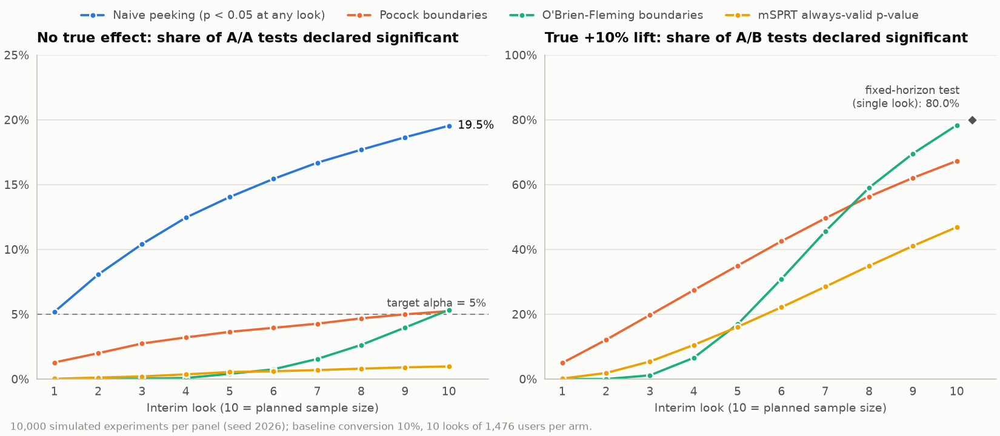

# powerlift

Statistics for A/B tests: power analysis, frequentist and Bayesian analysis,
variance reduction, sequential monitoring and sanity checks, checked against
SciPy and statsmodels.

[](https://github.com/ult666666/powerlift/actions/workflows/ci.yml)
[](LICENSE)
[](pyproject.toml)

## Why

Most A/B-testing mistakes are statistical, not engineering ones:

- **Underpowered tests.** Without a sample-size plan, "no significant
  difference" usually means "not enough data".
- **Peeking.** Checking the p-value every day and stopping at the first
  `p < 0.05` turns a 5% false-positive rate into about 19% after 10 looks (see
  the [peeking simulation](#peeking-simulation)).
- **Sample ratio mismatch (SRM).** A 50/50 test that ends up 50,800 vs 49,200
  users has p = 4e-7 under the planned split: something is wrong with
  assignment or logging, and the results cannot be trusted.
- **Multiple comparisons.** Testing 10 independent metrics at `alpha = 0.05`
  gives a 40% chance of at least one false win.
- **Wrong variance.** Analysing sessions as independent when users were
  randomized understates the standard error.

powerlift implements the standard remedies as small, typed, documented
functions whose results are checked against independent references.

## Features

| Module | What it does |
|---|---|
| `powerlift.design` | Sample size, power and MDE for two proportions (pooled z-test) or two means; experiment duration from daily traffic |
| `powerlift.analysis` | Two-proportion z-test with Wilson, Newcombe and Wald intervals and a log-ratio interval for the relative lift; Welch's t-test; delta-method analysis of ratio metrics |
| `powerlift.sanity` | SRM chi-square check; A/A simulation of a test's false-positive rate and p-value uniformity |
| `powerlift.cuped` | CUPED variance reduction with a pre-experiment covariate |
| `powerlift.multiple_testing` | Bonferroni, Holm and Benjamini-Hochberg adjustments |
| `powerlift.sequential` | Pocock, O'Brien-Fleming and Lan-DeMets group sequential boundaries; mSPRT always-valid p-values and confidence sequences |
| `powerlift.bayes` | Beta-Binomial posteriors, P(B > A), expected loss and credible intervals |
| `powerlift` CLI | `sample-size`, `analyze` (counts or CSV), `srm` and `boundaries`, with text or JSON output |

Every result is a frozen dataclass with `.to_dict()` (JSON-ready) and
`.summary()` (also used by `print`). Invalid input raises
`powerlift.InvalidInputError` with a message that names the argument.

## Quick start

Install the library and the `powerlift` CLI from the GitHub release (Python 3.11+):

```bash
pip install https://github.com/ult666666/powerlift/releases/download/v0.1.0/powerlift-0.1.0-py3-none-any.whl
```

Each release also attaches the source distribution and SHA-256 checksums. To work on the code, install it from source with [uv](https://docs.astral.sh/uv/):

```bash
git clone https://github.com/ult666666/powerlift.git
cd powerlift
uv sync
```

Plan a test, then analyse it:

```python
>>> from powerlift import compare_proportions, sample_size_proportions
>>> plan = sample_size_proportions(baseline=0.10, mde=0.10, relative=True)
>>> print(plan)
Sample size: two proportions (two-sided pooled z-test, alpha = 0.05, power = 0.8)
  baseline rate    10.00%
  minimum effect   +1.00 pp (+10.00% relative) -> 11.00%
  allocation       n_treatment / n_control = 1
  required n       control 14,751 | treatment 14,751 | total 29,502
  achieved power   0.8000
>>> plan.duration_days(daily_traffic=4_000)
8
>>> print(compare_proportions(480, 5_000, 560, 5_000))
Two-proportion z-test (pooled), two-sided, alpha = 0.05
  control      480 / 5,000 =  9.60%   95% Wilson CI [8.81%, 10.45%]
  treatment    560 / 5,000 = 11.20%   95% Wilson CI [10.36%, 12.10%]
  difference   +1.60 pp   95% CI [+0.40 pp, +2.80 pp] (Newcombe)
  lift         +16.67%   95% CI [+3.95%, +30.94%] (log-ratio delta method)
  z = 2.621, p-value = 0.0088 (significant at alpha = 0.05)

```

## Usage

### Command line

```console
$ uv run powerlift analyze --control 480/5000 --treatment 560/5000 --bayes
Two-proportion z-test (pooled), two-sided, alpha = 0.05
  control      480 / 5,000 =  9.60%   95% Wilson CI [8.81%, 10.45%]
  treatment    560 / 5,000 = 11.20%   95% Wilson CI [10.36%, 12.10%]
  difference   +1.60 pp   95% CI [+0.40 pp, +2.80 pp] (Newcombe)
  lift         +16.67%   95% CI [+3.95%, +30.94%] (log-ratio delta method)
  z = 2.621, p-value = 0.0088 (significant at alpha = 0.05)

Bayesian Beta-Binomial comparison, prior Beta(1, 1) for each arm
  control      Beta(481, 4521): mean 9.62%, 95% credible interval [8.81%, 10.45%]
  treatment    Beta(561, 4441): mean 11.22%, 95% credible interval [10.36%, 12.10%]
  P(treatment > control)          0.9956
  expected loss, ship treatment   0.0008 pp
  expected loss, keep control     1.6002 pp
  difference     95% credible interval [+0.40 pp, +2.79 pp]
  relative lift  95% credible interval [+3.92%, +30.90%]
  (intervals for the difference and lift: 200,000 Monte Carlo draws, seed 0)

$ uv run powerlift srm --observed 50421 49579
Sample ratio mismatch check (chi-square goodness of fit)
  arm 1: observed 50,421 (50.421%), expected 50,000.0 (50.000%)
  arm 2: observed 49,579 (49.579%), expected 50,000.0 (50.000%)
  chi2 = 7.090, df = 1, p-value = 0.0078
  no SRM detected (p >= 0.001)

$ uv run powerlift boundaries --looks 4 --method lan-demets-obrien-fleming
Lan-DeMets (O'Brien-Fleming-type spending) boundaries: two-sided alpha = 0.05, 4 looks
  look  information  |z| boundary  nominal alpha  cumulative alpha
  1     0.250        4.3326        0.000015       0.000015
  2     0.500        2.9631        0.003045       0.003051
  3     0.750        2.3591        0.018321       0.019299
  4     1.000        2.0141        0.044000       0.050000
```

`powerlift sample-size --baseline 0.10 --mde 0.10 --relative --daily-traffic 4000`
prints the plan shown in the quick start plus the line
`duration         8 days at 4,000 eligible units/day`.
`powerlift analyze --csv data.csv --group-col group --value-col revenue` runs
Welch's t-test on per-unit data; add `--metric proportion` (0/1 values),
`--metric ratio --denominator-col sessions`, or `--covariate-col pre_revenue`
(CUPED). Every command accepts `--json`; see `uv run powerlift <command> --help`.

### Complete CSV experiment readout

Run a fictional checkout experiment from its checked-in per-user CSV through
SRM checks and CUPED analysis:

```bash
uv run python examples/experiment_readout.py --as-of 2026-09-15
```

The example blocks inference on SRM, incomplete outcome windows or insufficient
enrollment. On its 400 synthetic users, CUPED cuts the estimated variance by
65.2% and the adjusted confidence interval still includes zero. The estimate is
negative even though the data generator adds $0.50 to treatment revenue: one
small sample can miss the true effect. The
[walkthrough](docs/EXPERIMENT_READOUT.md) explains the fixed plan, covariate timing,
expected output, blocked cases and seed-based data regeneration.

### Variance reduction, multiple testing, sequential and Bayesian analysis

```python
>>> import numpy as np
>>> from powerlift import compare_means_cuped
>>> rng = np.random.default_rng(0)
>>> pre = rng.gamma(2.0, 10.0, size=(2, 5_000))  # pre-period spend per user
>>> post = 0.8 * pre + rng.normal(0.0, 8.0, size=(2, 5_000))
>>> post[1] += 0.5  # true treatment effect
>>> print(compare_means_cuped(post[0], pre[0], post[1], pre[1]))
CUPED (Deng et al. 2013): theta = 0.8082, corr(metric, covariate) = 0.820
  variance of the estimate reduced by 67.2% (corr^2 = 67.2%)
  unadjusted  difference +0.262933   95% CI [-0.285125, +0.81099]   p-value = 0.3470
  adjusted    difference +0.402497   95% CI [+0.0888451, +0.716148]   p-value = 0.0119

>>> from powerlift import adjust_p_values
>>> adjust_p_values([0.01, 0.04, 0.03, 0.005], method="holm").adjusted_p_values
(0.03, 0.06, 0.06, 0.02)

>>> from powerlift import crossing_probability, group_sequential_boundaries
>>> round(crossing_probability([1.96] * 10), 3)  # 10 looks at |z| >= 1.96
0.193
>>> design = group_sequential_boundaries(5, method="obrien-fleming")
>>> [round(z, 3) for z in design.z_boundaries]
[4.562, 3.226, 2.634, 2.281, 2.04]
>>> design.first_crossing([1.2, 2.9, 2.7])  # z-statistics at looks 1-3
3

>>> from powerlift import always_valid_inference
>>> monitor = always_valid_inference(
...     estimates=[0.004, 0.006, 0.009], standard_errors=[0.006, 0.004, 0.003], tau=0.01
... )
>>> print(monitor)
mSPRT always-valid inference (tau = 0.01, alpha = 0.05), 3 looks
  latest estimate      +0.009 (se 0.003)
  always-valid p-value 0.0561
  confidence sequence  [-0.000123794, +0.0181238]
  H0 (effect = 0) not rejected

>>> from powerlift import compare_proportions_bayes
>>> round(compare_proportions_bayes(480, 5_000, 560, 5_000).prob_treatment_better, 4)
0.9956

```

The mSPRT example shows the price of peeking: a fixed-horizon z-test on the
last look alone would give `z = 3` (p = 0.0027), but after three looks the
always-valid p-value is 0.056.

### A/A simulation

`simulate_aa` runs a test on many simulated experiments with no true effect. A
calibrated test is falsely significant about `alpha` of the time and its
p-values are uniform:

```python
>>> from powerlift import compare_means, simulate_aa
>>> def one_aa_test(rng):
...     return compare_means(rng.lognormal(size=500), rng.lognormal(size=500)).p_value
>>> print(simulate_aa(one_aa_test, n_simulations=2_000, seed=1))
A/A simulation: 2,000 experiments (seed 1)
  false-positive rate  4.45% (95% CI [3.63%, 5.44%]), nominal 5.00%
  KS test vs Uniform(0, 1): D = 0.0163, p-value = 0.6557

```

### Peeking simulation

[`examples/peeking_simulation.py`](examples/peeking_simulation.py) plans a test
for a 10% baseline and a +10% relative lift (14,751 users per arm), analyses it
at 10 equally spaced looks of 1,476 users per arm, and compares stopping rules
over 10,000 simulated A/A and 10,000 A/B experiments (seed 2026). Run it with
`uv run python examples/peeking_simulation.py`.



| Stopping rule | False-positive rate (A/A) | Power (true +10% lift) |
|---|---:|---:|
| Fixed horizon (single look at the end) | 5.3% | 80.0% |
| Naive peeking (p < 0.05 at any look) | 19.5% | 86.6% |
| Pocock boundaries | 5.2% | 67.3% |
| O'Brien-Fleming boundaries | 5.3% | 78.3% |
| mSPRT always-valid p-value | 1.0% | 46.9% |

Naive peeking nearly quadruples the false-positive rate. Both group sequential
designs keep it at 5% up to Monte Carlo error (about 0.2 percentage points).
O'Brien-Fleming gives up little power because it is strict early; Pocock gives
up more. The mSPRT is valid under *continuous* monitoring, so with only 10
looks it is conservative and less powerful at this sample size; its advantage
is that it needs no planned number of looks.

## How it works

- **Design** uses the normal approximation. For proportions the variance under
  H0 uses the pooled rate (matching the pooled z-test) and the variance under
  H1 is unpooled.
- **Analysis** computes each test from first principles (z, Welch t, delta
  method), with intervals that behave well for small rates (Wilson, Newcombe).
- **Group sequential boundaries** use the fact that sequential z-statistics are
  multivariate normal with `corr(Z_i, Z_j) = sqrt(t_i / t_j)`. The probability
  of first crossing at each look is a rectangle probability computed with
  `scipy.stats.multivariate_normal.cdf`; constants come from Brent's method.
- **mSPRT** compares a normal mixture alternative with the null. The
  likelihood ratio is a martingale under H0, so Ville's inequality makes
  `1 / max(likelihood ratio)` an always-valid p-value.

Formulas, assumptions and references: [docs/METHODOLOGY.md](docs/METHODOLOGY.md).
Architecture and design decisions: [docs/DESIGN.md](docs/DESIGN.md).

## Correctness

Tests compare against independent implementations or published values, not
just "it runs". Simulations use fixed seeds.

| What | Checked against |
|---|---|
| Proportion sample size and power | statsmodels `samplesize_proportions_2indep_onetail` and `power_proportions_2indep` (power agrees to 1e-10) |
| Mean sample size and power | statsmodels `NormalIndPower`; the `16 sd^2 / mde^2` rule of thumb |
| Planned n gives planned power | 2,000 simulated experiments analysed with powerlift |
| z-test, Wilson, Newcombe, Wald and log-ratio intervals | statsmodels `proportions_ztest`, `proportion_confint` and `confint_proportions_2indep` on Hypothesis-generated counts |
| Welch's t-test | `scipy.stats.ttest_ind(equal_var=False)` and `ttest_ind_from_stats` |
| Ratio metrics | covariance form of the delta method; simulated sampling SD and 95% coverage |
| CUPED | pooled regression slope; simulated variance reduction close to rho^2, unbiased estimate, 95% coverage |
| SRM | `scipy.stats.chisquare` |
| Calibration of every test | A/A simulations: false-positive rate and KS uniformity test |
| Multiple testing | statsmodels `multipletests`; simulated FWER and FDR |
| Group sequential boundaries | Jennison & Turnbull's Pocock and O'Brien-Fleming constants (K = 2-5 and 10); published Lan-DeMets bounds; 400,000-path simulations of the type-I error |
| mSPRT | closed-form mixture likelihood ratio; p-value / confidence-sequence duality; continuous-monitoring simulation |
| Bayesian P(B > A) and expected loss | Evan Miller's closed form; Monte Carlo |

## Development

```bash
uv sync                                              # environment from uv.lock
uv run ruff check . && uv run ruff format --check .  # lint and formatting
uv run mypy                                          # strict type checking
uv run pytest --cov                                  # tests, docstring examples, coverage
uv run pytest --doctest-glob="README.md" README.md   # this README's examples
```

CI runs the same steps, plus a CLI smoke test, on Python 3.11, 3.12 and 3.13.

## Limitations and roadmap

- All frequentist methods use large-sample normal approximations. There are no
  exact tests (such as Fisher's) for very small samples, and the design
  formulas are z-based (a t-based design needs slightly more units below about
  30 per arm).
- Intervals are always two-sided, even when the test is one-sided.
- Two arms only: no multi-arm designs or Dunnett-style comparisons.
- `experiment_duration` assumes every day brings new, distinct units.
- CUPED uses a single covariate and treats `theta` as fixed; ratio-metric and
  relative-lift intervals rely on the first-order delta method.
- Group sequential designs are two-sided and efficacy-only (no futility
  bounds), and the maximum sample size inflation is not computed. Boundaries
  come from quasi-Monte Carlo integration (accurate to about 1e-4); the cost
  grows with the number of looks (under a second for 10, up to about 11 s for
  20 with Lan-DeMets spending).
- The mSPRT uses plug-in variances, needs a user-chosen `tau` and is
  two-sided only.
- The Bayesian module covers conversion metrics with independent Beta priors.
- Benjamini-Hochberg assumes independent or positively dependent tests.

Roadmap: futility and one-sided boundaries via recursive numerical integration
(Jennison & Turnbull, ch. 19), sample size inflation for sequential designs,
regression adjustment with several covariates, bootstrap intervals, Bayesian
models for continuous metrics, and multi-arm designs.

## References

- Kohavi, R., Tang, D., & Xu, Y. (2020). *Trustworthy Online Controlled Experiments*. Cambridge University Press.
- Deng, A., Xu, Y., Kohavi, R., & Walker, T. (2013). Improving the sensitivity of online controlled experiments by utilizing pre-experiment data. *WSDM 2013*.
- Deng, A., Knoblich, U., & Lu, J. (2018). Applying the delta method in metric analytics: a practical guide with novel ideas. *KDD 2018*.
- Johari, R., Koomen, P., Pekelis, L., & Walsh, D. (2017). Peeking at A/B tests: why it matters, and what to do about it. *KDD 2017*.
- Jennison, C., & Turnbull, B. W. (2000). *Group Sequential Methods with Applications to Clinical Trials*. Chapman & Hall/CRC.
- Newcombe, R. G. (1998). Interval estimation for the difference between independent proportions: comparison of eleven methods. *Statistics in Medicine*, 17(8), 873-890.
- Wilson, E. B. (1927). Probable inference, the law of succession, and statistical inference. *JASA*, 22(158), 209-212.

Further references (Lan & DeMets, Holm, Benjamini & Hochberg, Welch, Fabijan
et al.) are in [docs/METHODOLOGY.md](docs/METHODOLOGY.md).

## License

[MIT](LICENSE). Copyright (c) 2026 Charles Dai.
