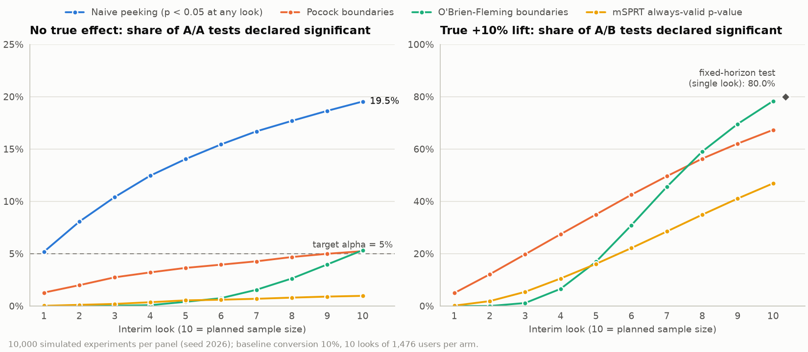

# Simulations

Two seeded simulations check the methods where it matters: whether the error rates
are what the theory says, and what each stopping rule costs in power. Both use
synthetic data only and run from a source checkout.

## Several treatment arms

[`examples/multi_arm_simulation.py`](../examples/multi_arm_simulation.py) checks
Dunnett's test by simulation; `uv run python examples/multi_arm_simulation.py` takes
about 90 seconds. In the first table every experiment has arms of 500 users with no
real difference, and "exact" is the rate the max-|t| distribution predicts. The
power rows simulate experiments at the planned sizes, with the effect in the plan
column present in every treatment arm:

```text
Family-wise error rate at alpha = 0.05, global null, 500 units per arm, 2,000 SYNTHETIC experiments per column
                    3 treatments      6 treatments
  adjustment    measured   exact  measured   exact
  none             13.5%   12.5%     20.4%   20.7%
  bonferroni        4.4%    4.4%      4.8%    4.1%
  holm              4.4%    4.4%      4.8%    4.1%
  dunnett           5.1%    5.0%      5.4%    5.0%

Power to detect the first treatment arm, 2,000 experiments per row
  plan                                                planned  simulated
  mean +0.1 sd, 3 arms, Dunnett, n = 2,036/arm          80.0%      79.7%
  10% -> 11%, 3 arms, Dunnett, n = 19,424/arm           80.0%      78.5%
  10% -> 11%, 3 arms, Bonferroni, n = 19,978/arm        80.0%      80.6%
```

Without adjustment, the chance of a false win grows from 12.5% to 20.7% when the
number of variants doubles. Dunnett's test stays at 5% within Monte Carlo error,
which is about 0.5 percentage points here, while Bonferroni and Holm fall below it.
Under this global null those two find a false win in exactly the same experiments:
both do so when the smallest p-value is below `alpha / k`. The planned sample sizes
deliver their planned power within about 1.5 percentage points, against a standard
error of 0.9.

## Peeking and sequential monitoring

[`examples/peeking_simulation.py`](../examples/peeking_simulation.py) plans a test
for a 10% baseline and a +10% relative lift, which needs 14,751 users per arm. It
analyses the test at ten equally spaced looks, each adding 1,476 users per arm. It
then compares stopping rules on 10,000 simulated A/A experiments and as many A/B
experiments, all from seed 2026. Run it with
`uv run python examples/peeking_simulation.py`.



| Stopping rule | False-positive rate (A/A) | Power (true +10% lift) |
|---|---:|---:|
| Fixed horizon (single look at the end) | 5.3% | 80.0% |
| Naive peeking (p < 0.05 at any look) | 19.5% | 86.6% |
| Pocock boundaries | 5.2% | 67.3% |
| O'Brien-Fleming boundaries | 5.3% | 78.3% |
| mSPRT always-valid p-value | 1.0% | 46.9% |

Naive peeking nearly quadruples the false-positive rate. Both group sequential
designs keep it at 5% up to Monte Carlo error (about 0.2 percentage points).
O'Brien-Fleming gives up little power because it is strict early; Pocock gives
up more. The mSPRT is valid under *continuous* monitoring, so with only 10
looks it is conservative and less powerful at this sample size; its advantage
is that it needs no planned number of looks.
